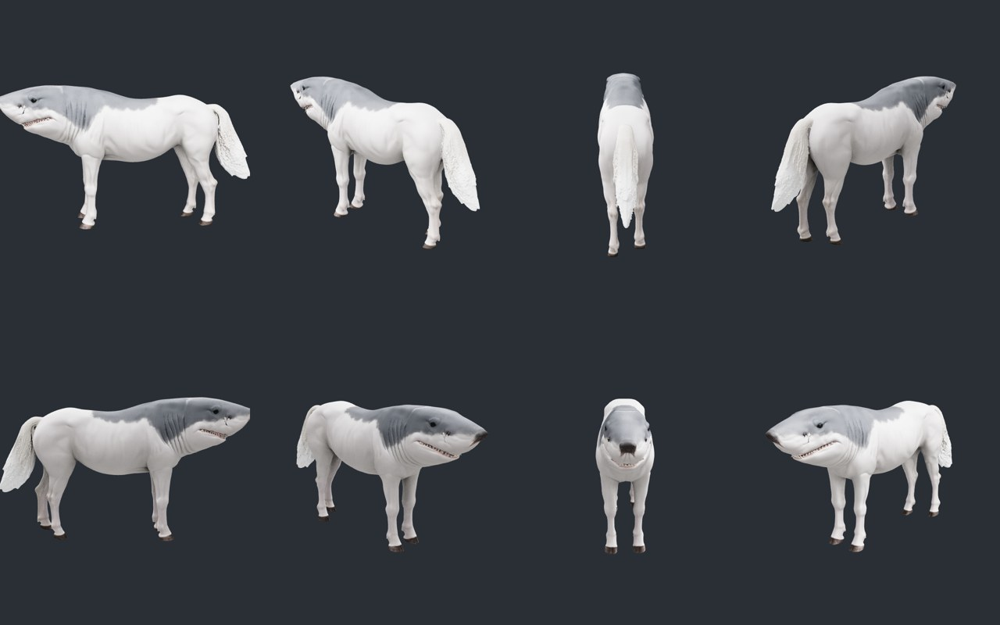
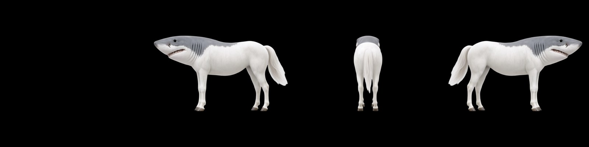
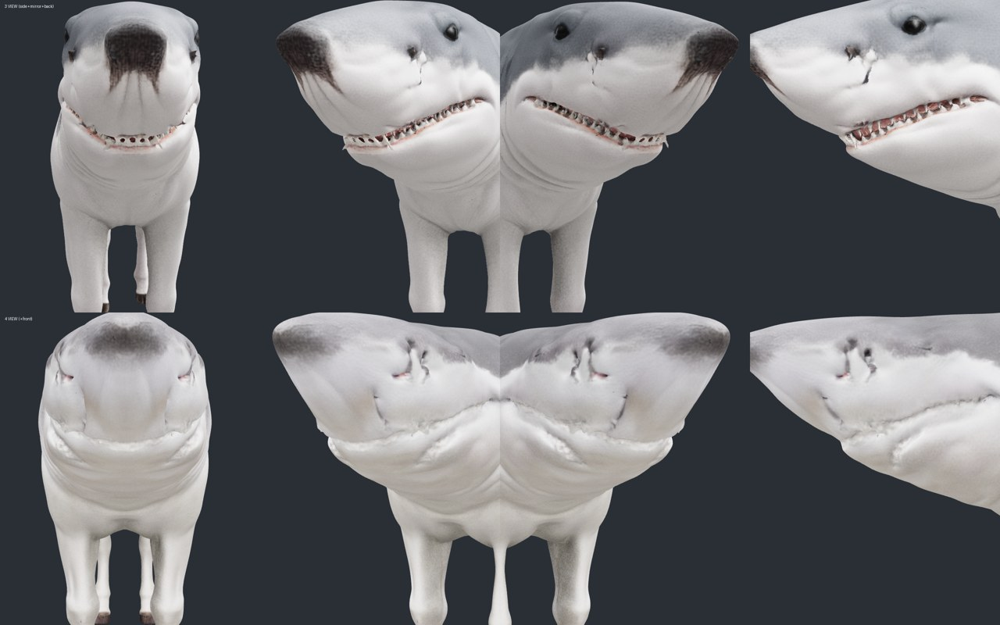

# Multi-View Kit for ComfyUI

**One character image in, a textured 3D model (GLB) out, in a single ComfyUI workflow.**



```
character image
  └─ Qwen-Image 2.1 edit ──► side view ──► front view + back view
       └─ Multi-View Views ──► save views / reuse saved views
            └─ Multi-View Scale Normalize ──► cutout, same scale, mirrored opposite side
                 └─ Pixal3D (TRELLIS.2) multi-view ──► mesh + baked PBR textures ──► .glb
```

## Why

Pixal3D multi-view expects every view framed like a fixed camera rig: the same scale in every view, with the object spanning about 1/1.1 of the frame at its widest. ComfyUI's bundled `Crop Image to Mask` fits each view to its own bounding box, so a long creature's front view ends up much bigger than its side view, and the mesh grows duplicate features such as double eyes or a second face.

This kit fixes the framing, generates the views for you, and lets you re-run only the 3D part while you experiment.

## Quick start

1. Install the nodes and restart ComfyUI:
   ```bash
   cd ComfyUI/custom_nodes
   git clone https://github.com/nabotz/comfyui-multiview-kit
   ```
2. Drag [`example_workflows/image_to_3d_multiview.json`](example_workflows/image_to_3d_multiview.json) onto the canvas.
3. Load your image, describe the character in **Multi-View Prompts**, and run.

No extra Python packages are needed: it uses torch, numpy and PIL, plus scipy for speck removal if it is installed.

## Nodes

### Multi-View Prompts (Qwen edit)
Builds the three edit prompts (side view facing left, front, back) from a short `subject` and optional `details`. The templates are editable on the node. The front and back templates tell Qwen not to leave a faint "ghost" of the side view in the background.

### Multi-View Views (generate / reuse)
- **`generate`**: runs the Qwen branch and saves `side.png`, `front.png` and `back.png` to `output/<folder>/`.
- **`reuse saved`**: loads those files instead of running the Qwen branch, so you can try other view combinations in a few minutes. ComfyUI still validates the whole graph, so the input image and the Qwen model files must exist.
- `include_front` / `include_back`: views that are switched off are neither generated nor used.
- Each `generate` run writes `views.json` listing the views it made, so `reuse saved` refuses to mix in an old view left over from a previous character. Changed files on disk are picked up on the next run.

### Multi-View Scale Normalize (Pixal3D)
- Cuts out every view with BiRefNet and drops stray specks.
- Scales all views to the side view's height and frames them on one square canvas.
- Mirrors the side view to make the opposite side, so both flanks match exactly. Asymmetric characters become symmetric this way; to keep the asymmetry, turn `mirror_other_side` off and connect your own `other_side_image`.
- Optional mask inputs expect foreground = 1 (like Remove Background). A LoadImage MASK is inverted, so invert it first.
- Outputs `front / left / back / right` for **Pixal3D Multi-View Conditioning**, plus a preview strip. Disabled views output nothing, and Pixal3D skips them.



## Requirements

- A recent ComfyUI with the core Pixal3D / TRELLIS.2 and Qwen-Image 2.1 nodes. Tested on ComfyUI 0.43.0 and 0.43.2 (Comfy Desktop, Windows).
- [ComfyUI-GGUF](https://github.com/city96/ComfyUI-GGUF), only because the example loads Qwen-Image as GGUF. Swap the loader if you use other weights.

Models used by the example workflow:

| Stage | Folder | File |
|---|---|---|
| Qwen edit | `models/diffusion_models` | `qwen-image-2.1-UC-Q8_0.gguf` ¹ |
| Qwen edit | `models/text_encoders` | `qwen3vl_8b_int8_convrot.safetensors` |
| Qwen edit | `models/vae` | `qwen_image_2.1_vae_bf16.safetensors` |
| Cutout | `models/background_removal` | `birefnet.safetensors` |
| Pixal3D | `models/diffusion_models` | `pixal3d_multiview_int8_convrot.safetensors` |
| Pixal3D | `models/clip_vision` | `dino_v3_L_naf_fp32.safetensors` |
| Pixal3D | `models/vae` | `trellis_2_shape_vae_bf16.safetensors` |
| Pixal3D | `models/vae` | `trellis_2_texture_vae_bf16.safetensors` |

¹ A community GGUF build of Qwen-Image 2.1. Any Qwen-Image 2.1 weights that support edit mode work.

Check each model's license before using the results commercially.

## Usage

1. **Load an image.** Any pose or angle works; full body works best.
2. **Describe the character** in Multi-View Prompts: `subject` (e.g. `shark-horse creature`) and `details` (head, colors, limbs, tail). English works best.
3. **Pick the view size:** 1280×960 for animals and long creatures, 960×1280 for humanoids.
4. **Run** with Multi-View Views on `generate`, then check the `views_normalized` preview (front | left | back | right).
5. **Iterate:** switch to `reuse saved`, toggle `include_front` / `include_back`, and run again. Only the cutout and 3D part run.
6. **Get the result** from `output/3d/mv3d_*.glb`.

For a new character, switch back to `generate`, or change `folder` to keep the old views.

## Tips

- **Consistent views beat more views.** Pixal3D has four fixed slots (0°, 90°, 180°, 270°, at eye level), and one inconsistent view does more damage than a missing one.
- **For long snouts (sharks, horses, crocodiles), start without the front view.** Qwen tends to draw a cartoon face with forward-facing eyes from the front, which conflicts with the side view and blurs the eyes and teeth on the mesh.

  

- **Without a front view, the very tip of a snout is a blind spot.** Its texture is guessed from nearby pixels and can come out dark. Touch it up in Blender, or use the front view when it comes out clean.
- **Use `reuse saved` while experimenting.** Comfy Desktop uses a RAM-pressure cache, so with Qwen and Pixal3D in one graph the cached Qwen outputs usually get evicted between runs.

## Performance

Rough timings on an RTX 5060 Ti 16 GB with 32 GB RAM:

| Run | Time |
|---|---|
| `generate`, side + back views, then 3D | ~7 min |
| `generate`, all three views, then 3D | ~8–9 min |
| `reuse saved` (3D only) | ~2.7 min |

## Repository layout

```
__init__.py                    node registration
src/nodes.py                   the three nodes
example_workflows/             ready-to-load workflow
docs/                          images used in this README
```

## Credits

- The 3D half of the example workflow is based on ComfyUI's Pixal3D multi-view template (MIT).
- Pixal3D / TRELLIS.2, Qwen-Image 2.1 and BiRefNet belong to their respective authors.
- Built with Claude (Anthropic) working as an agent that drove ComfyUI through MCP.

## License

[MIT](LICENSE)
